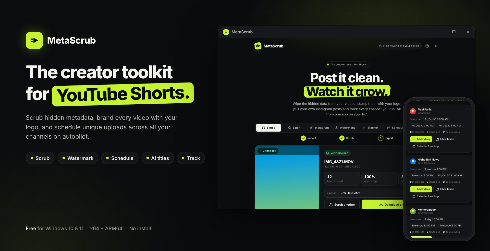
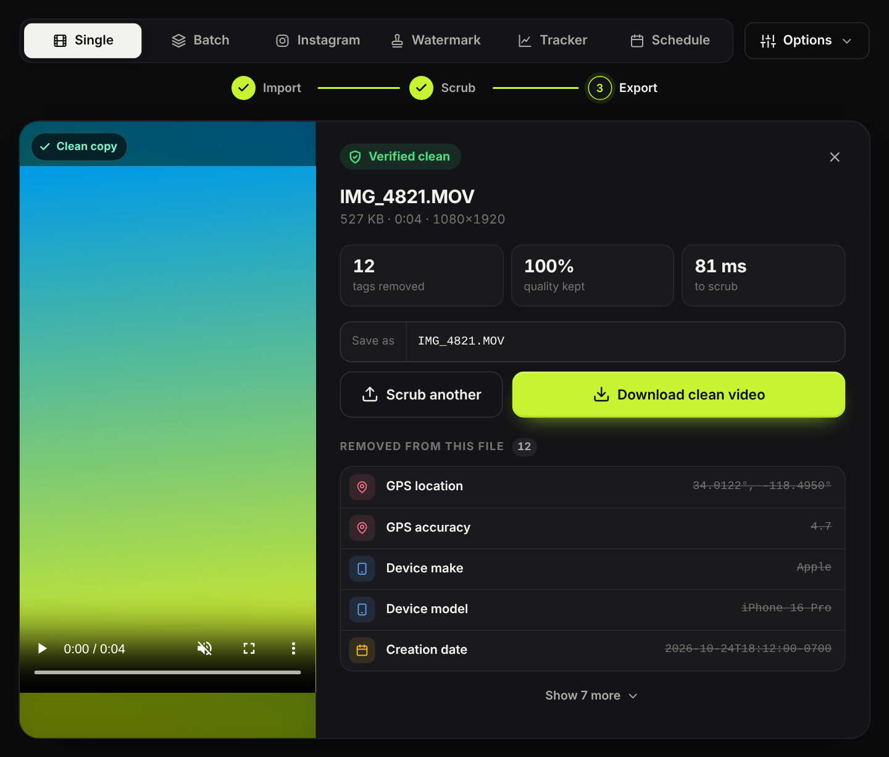
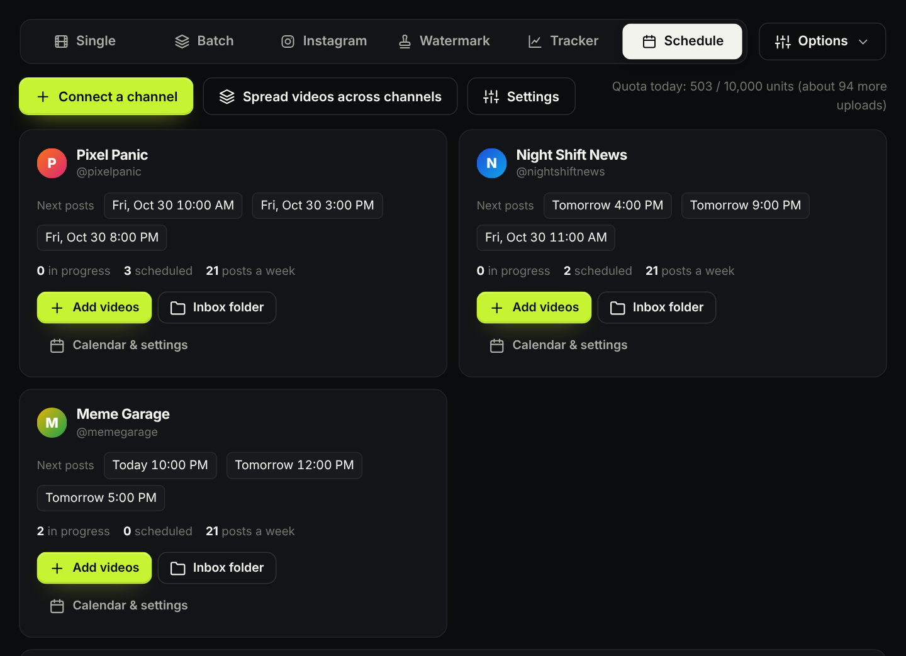
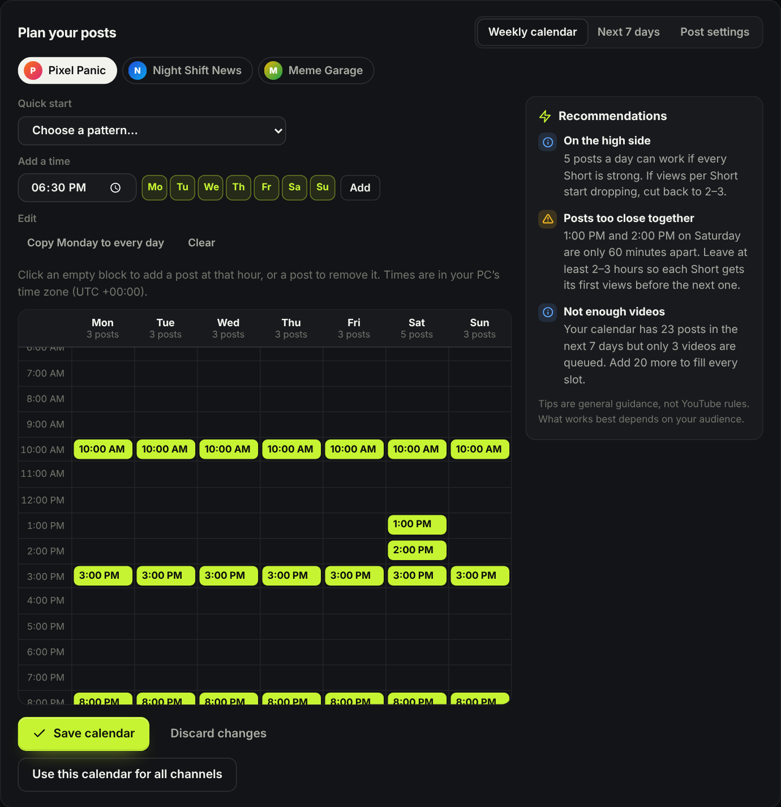
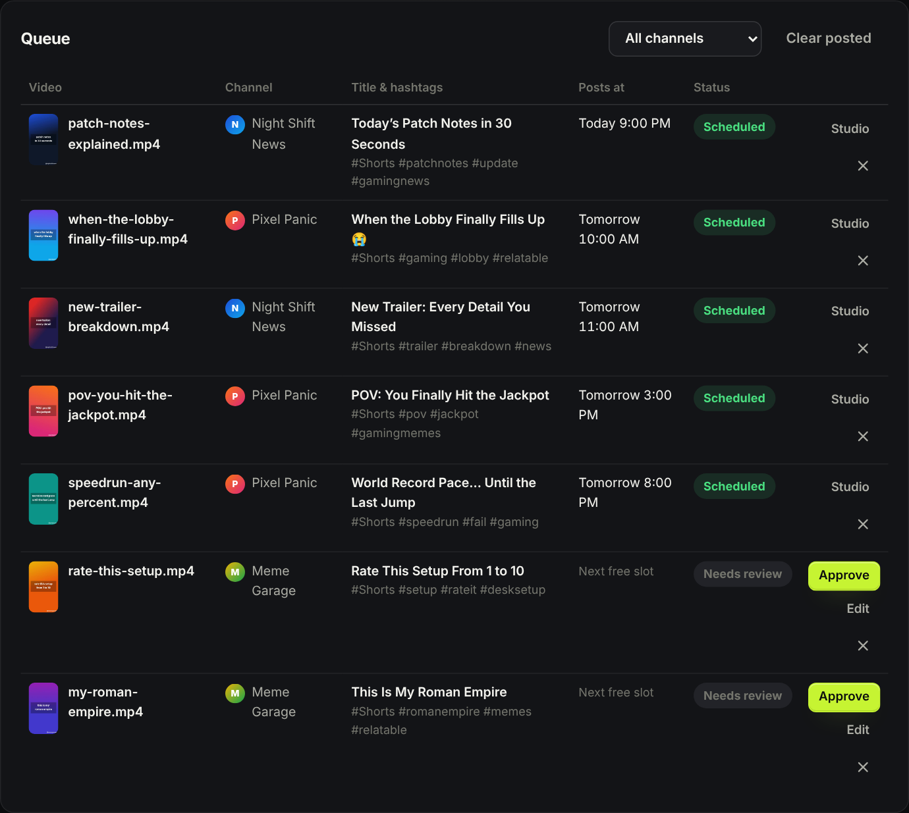
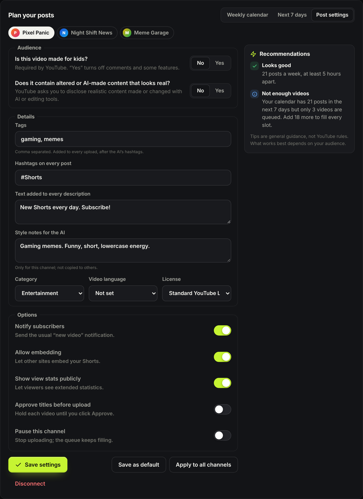
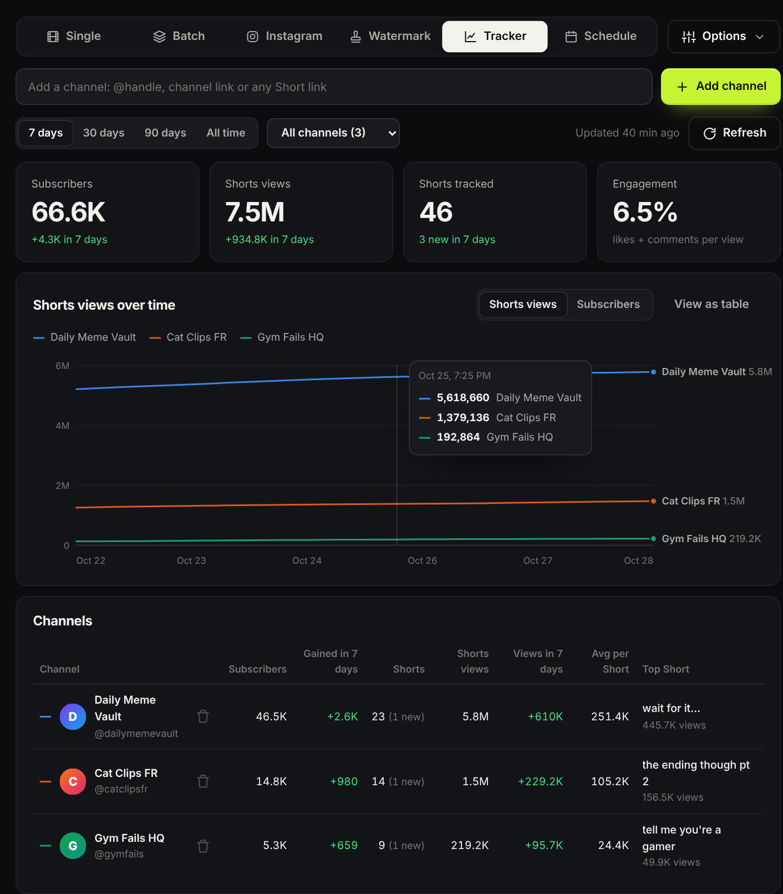
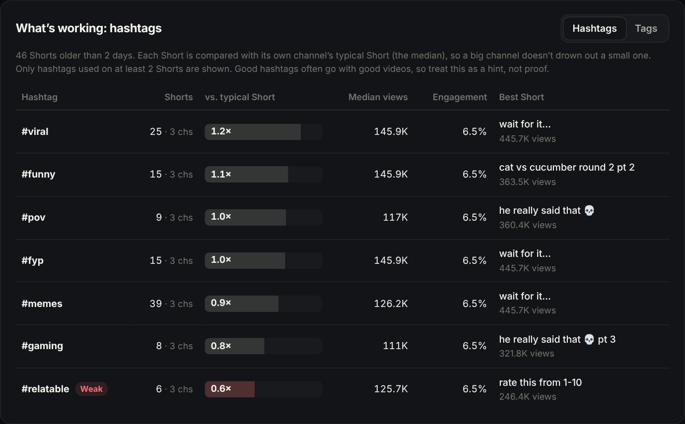
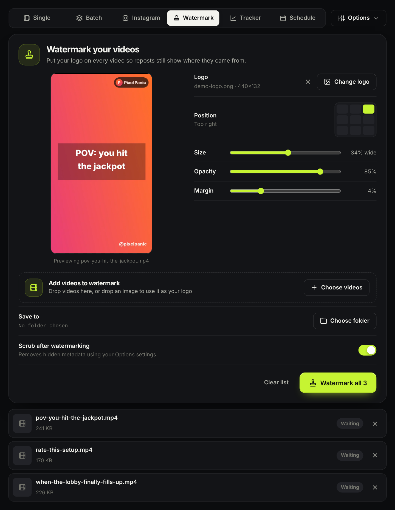
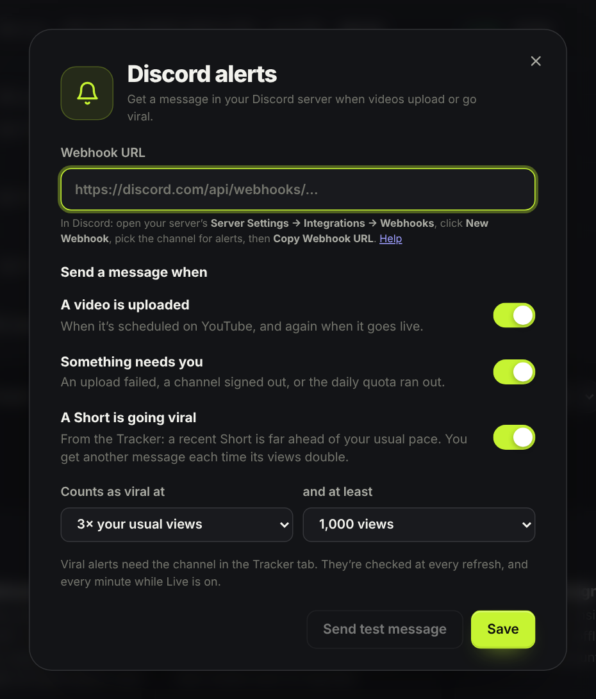

  <a href="https://github.com/MikeytScripts/MetaScruber/releases/latest"><b>⬇ Download for Windows</b></a>
  &nbsp;·&nbsp;
  <a href="https://discord.gg/HnqkyDkFUA"><b>🔑 Get a license key on Discord</b></a>

# MetaScrub

The creator toolkit for YouTube Shorts, in one Windows app. The download is free; you need a **license key** to use it. **[Get one on our Discord](https://discord.gg/HnqkyDkFUA).**

| | |
|---|---|
| 🧽 **Scrub** | Strip GPS, device, dates, encoder tags and edit history. No re-encoding, no quality loss. |
| 🏷️ **Watermark** | Your logo on every video, in one of nine positions, with a live preview. |
| 📅 **Schedule** | Connect all your channels, spread a batch of videos across them (one channel per video), and post on a weekly calendar you design. |
| 🤖 **AI titles** | Titles, descriptions and hashtags written from each video, learning from your best-performing Shorts. |
| 📈 **Track** | Live stats, 24-hour and longer gains, newest-Short pace and which hashtags work best. |
| 🔔 **Discord alerts** | Get pinged when videos upload, when something needs you, and when a Short goes viral. |

## Get started

1. **[Download MetaScrub.exe](https://github.com/MikeytScripts/MetaScruber/releases/latest)** (or `MetaScrub-arm64.exe` for ARM laptops) and double-click it. Nothing to install.
2. **[Get a license key on Discord](https://discord.gg/HnqkyDkFUA).**
3. Enter the key when MetaScrub asks. Each key works on one PC.

Windows SmartScreen may warn you the first time because the app isn't code-signed yet: click **More info → Run anyway**.

## Screenshots

<table>
  <tr><td width="50%">
Every channel, its next posts
</td>
      <td width="50%">
Weekly calendar with recommendations
</td></tr>
  <tr><td>
AI titles and posting times
</td>
      <td>
Post settings saved as defaults
</td></tr>
  <tr><td>
Tracker
</td>
      <td>
Which hashtags work
</td></tr>
  <tr><td>
Watermark
</td>
      <td>
Discord alerts
</td></tr>
</table>

## Support

Questions, keys and updates: **[discord.gg/HnqkyDkFUA](https://discord.gg/HnqkyDkFUA)**

[Privacy policy](privacy.html) · [Terms of service](terms.html)
